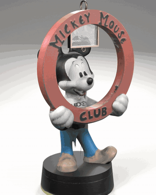
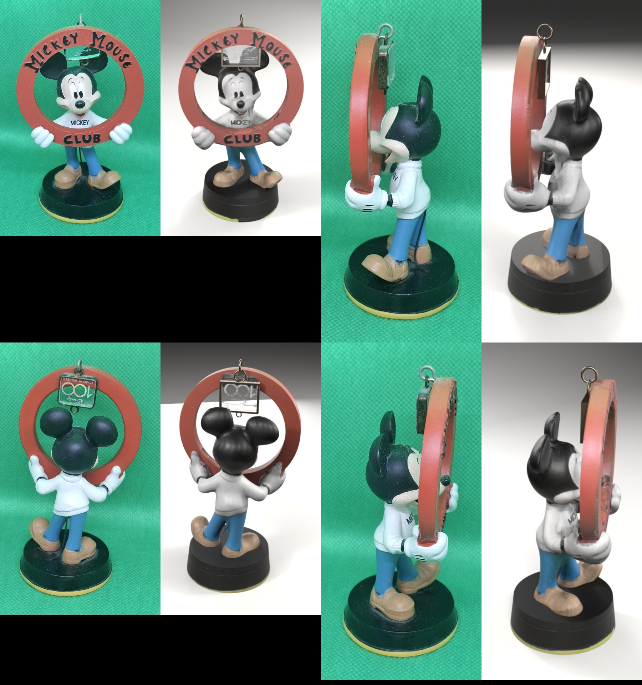
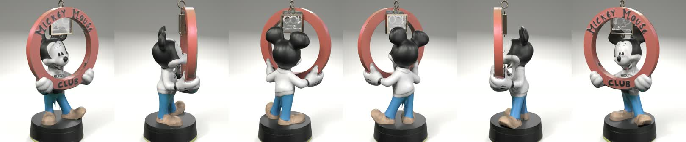
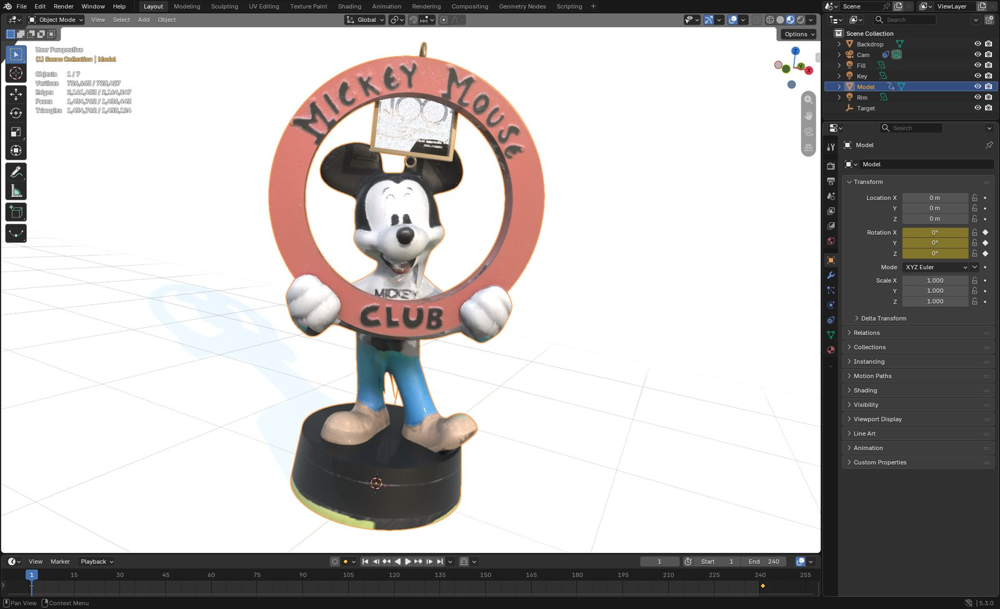
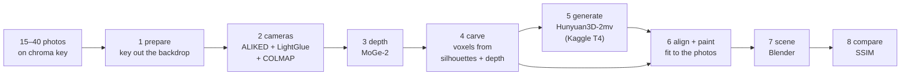
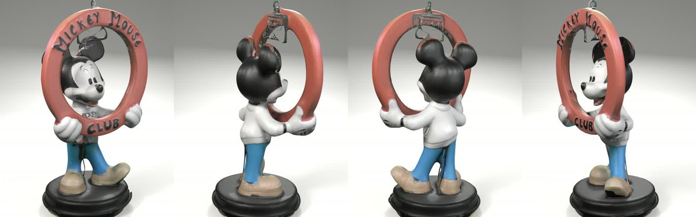
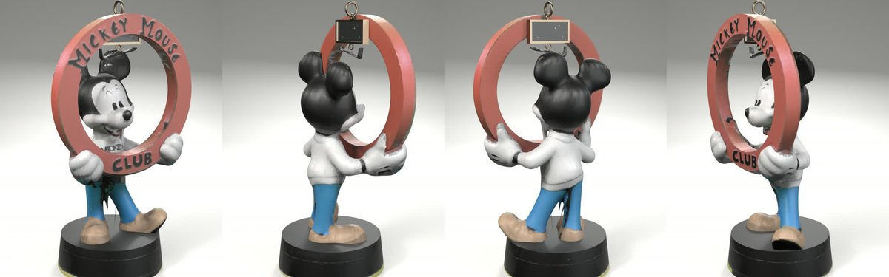
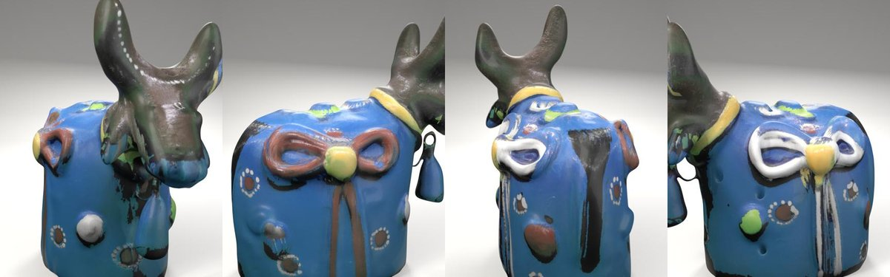
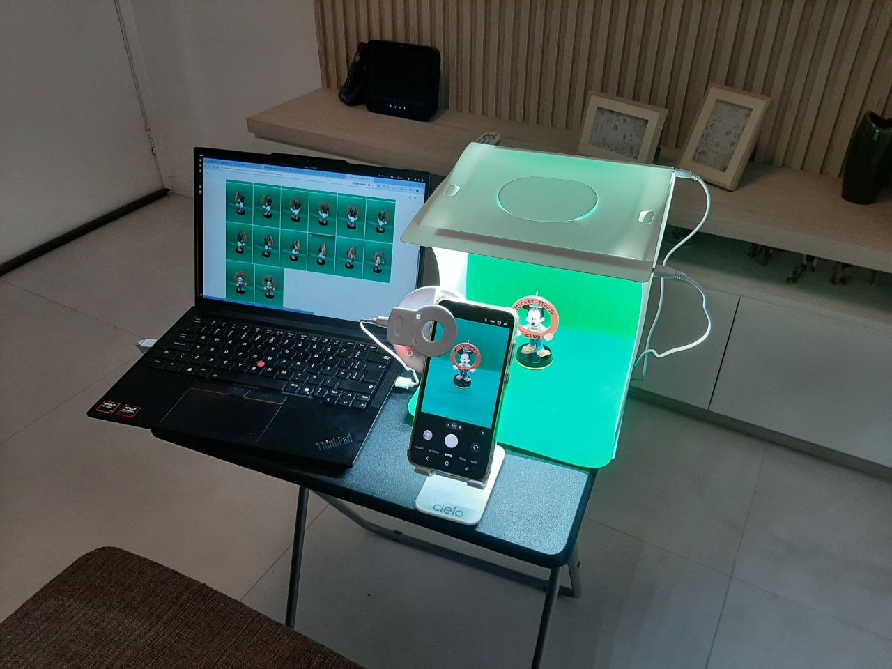

# twinlens: a phone, a chroma key backdrop and a painted 3D model

🌐 **English** · [Português (Brasil)](README.pt-BR.md)

**Photos of a small object on a green chroma key backdrop, turned into a painted 3D model and a Blender studio scene by open AI models.**

> A personal study by **Claudio Escudero** ([claudioescudero.com](https://claudioescudero.com) · [linkedin.com/in/claudioescudero](https://www.linkedin.com/in/claudioescudero/)). It is not a product. The code is shared so others can read it, reproduce the results and try it on their own objects.

<p align="center">
  
</p>

**The question:** can 20 phone photos, a chroma key backdrop and open models give a painted 3D model of a small object, good enough for a studio render, on a laptop and with no scanner?

**Short answer:** for shape and colour, yes. On a 20-photo figurine, every photo was placed, the model's silhouette matches the photos at IoU 0.89, and renders through the photos' own cameras score SSIM 0.67 on the object. Fine print, glass and thin wire did not come out from the photos: they needed a profile, a small file of rules for that one object ([Profiles](#profiles-rules-for-one-object)). A second object, run with no profile, kept its shape but picked up stains on its glossy parts ([What went wrong](#what-went-wrong)).

## The result

Photos (green) next to renders of the model through the same cameras (white):

<p align="center"></p>

The Blender studio scene, from four angles:



The model open in Blender: one mesh of 727k vertices, coloured by the photos, inside the studio scene (`model.blend`):

<p align="center"></p>

The figurine is the author's own, photographed in a small light box with a green backdrop ([the setup](#taking-the-photos)): 20 photos at 1.75× digital zoom, all at about the same height.

## How it works



| Step | Code | What it does |
|---|---|---|
| 1 | [`prepare.py`](twinlens/prepare.py) | Uprights the photos (EXIF) and keys out the chroma key backdrop, measured on each photo's border. A pixel is backdrop when it is about as green as the backdrop ("excess green" `G − max(R, B)`, at least 40% of the backdrop's) **and** has the backdrop's own shade (chromaticity, within 6 times the backdrop's spread). Then `run` stops for a look at the masks. |
| 2 | [`cameras.py`](twinlens/cameras.py) | Finds where each photo was taken from. ALIKED keypoints on the object only, LightGlue matches between neighbours, COLMAP's mapper. The focal length comes from EXIF (35 mm equivalent × digital zoom). |
| 3 | [`depth.py`](twinlens/depth.py) | MoGe-2 depth for each photo, on the CPU. |
| 4 | [`carve.py`](twinlens/carve.py) | Voxel carving from the silhouettes, then from depth (a voxel a photo saw through is air). This alone gives a complete painted model. It also finds which way is up: the photos circle the object, so their plane gives the vertical, and the table is found from each photo's lowest silhouette pixel. |
| 5 | [`generate.py`](twinlens/generate.py) | Hunyuan3D-2mv turns 4 photos (front, sides, back; picked by angle, background removed, green spill cleaned) into a smooth, closed mesh. It runs on a free Kaggle T4: the tool uploads a private dataset, pushes a private kernel, waits and downloads one mesh per seed. |
| 6 | [`align.py`](twinlens/align.py), [`paint.py`](twinlens/paint.py) | Places each generated mesh where the photos say: rotation, translation and per-axis scale that maximise silhouette IoU over all photos. Fine relief is smoothed off, so small details come from the photo paint rather than from slightly misplaced generated relief. Every candidate is painted, and the best is kept by silhouette IoU and photo consistency. |
| 7 | [`scene.py`](twinlens/scene.py) | Blender studio scene: seamless backdrop, three soft lights, turntable animation, stills and video. |
| 8 | [`compare.py`](twinlens/compare.py) | Renders through the real cameras next to the photos, scored by SSIM on the object. |

**Painting.** Each vertex takes the colour of the photo that agrees most with the others, among the 5 that see it most squarely (z-buffer visibility). This weighted medoid lets a photo that lands on the wrong part be outvoted, and no colour is invented by mixing. Green spill is removed, never past grey. Points the photos disagree on take their neighbours' colour.

Everything runs on a laptop CPU except step 5, which runs on Kaggle's GPU and can be skipped (`--gpu none` keeps the carved model).

## Profiles: rules for one object

The core knows nothing about any particular object. A profile is a Python file with optional hooks:

```python
def refine_voxels(occ, ctx): ...      # step 4: extra carving rules
def parts(mesh, ctx): ...             # step 6: swap pieces for exact shapes -> (mesh, {name: part}, state)
def clean_colours(mesh, ctx): ...     # step 6: colour rules after painting
```

`ctx` holds the config, the photos with their cameras (`views`), the upright `frame` and the pedestal, if any. Profiles can tag materials in the vertex alpha: 160 = metal, 80 = glass.

[`examples/mickey/profile.py`](examples/mickey/profile.py) is the profile for the figurine this study was built on. Its ring, glass tag and wire hook are drawn as vectors, measured on the model, and the ring is fitted to the photos' silhouettes (IoU 0.84 → 0.87). That made the ring's lettering sharp, which painting the generated ring could not do. Its colour rules know that only the tongue is red and that shoes and gloves are flat colours.

| Core only | With the profile |
|---|---|
|  |  |

### Writing a profile with an AI agent

You can write a profile by hand, but it is not simple: the rules take NumPy, a little geometry and several rounds of tuning thresholds while looking at the images. A coding agent that reads images and runs commands, such as [Claude Code](https://claude.com/claude-code), can do that tuning for you. Run the object without a profile, then, inside the project, use a prompt like this:

```text
I want a twinlens profile for the object `[OBJECT NAME]`. Find its work
folder and photos in the project; if there is more than one, ask me.

Use the "Profiles" section of the README and the example
examples/mickey/profile.py as reference. Everything goes in the profile: do
not change anything in twinlens/.

1. Compare the model with the photos (out/compare.jpg and out/stills/) and
   list what came out wrong. Do not write code yet: I confirm what to fix.
2. Write the profile and run `twinlens align` with --profile. Check the
   images and adjust until it is fixed, without breaking what was right.
3. At the end, show me the before and after.
```

The confirmation in step 1 matters: only you know what is right on the object. A glossy horn can look green in the photos themselves, reflecting the backdrop, and a black streak can be a defect or part of the paint. Review the profile before trusting it: a rule that is too broad repaints parts that were right.

## What went wrong

| Finding | Evidence | What changed |
|---|---|---|
| Classic SIFT could not place the photos | 8 of 20 photos of smooth plastic placed | Learned features on the object crop (ALIKED + LightGlue): 20 of 20 |
| Phones record the optical focal length even with digital zoom | The photos were at 1.75×, and the first camera solve was off | The focal length is multiplied by the zoom read from EXIF |
| Silhouettes cannot see concavities | With all photos at one height, carving left tents between parts, and the ears came out boxy | Depth carving helps; a generated shape aligned to the photos fixes it |
| "Green" is not enough to find the backdrop | Excess green alone keyed out green paint and the edges of dark glossy parts that mirror the backdrop. The backdrop's shade alone keyed out dark hollows lit only by green light | A pixel must pass both tests, with the backdrop measured on each photo's border |
| Glossy surfaces mirror the backdrop | Black plastic turned teal and white turned mint. Over-subtracting green turned whites magenta, and per-channel medians invented blue | Never despill past grey; medoid colours instead of medians |
| Generated relief is a little off the real one | Its shading doubled the painted eyes and letters | Fine relief is smoothed off before painting |
| Fine print, glass and thin wire | The tag and hook came out as a tangle ([Core only](#profiles-rules-for-one-object)) | Drawn as vectors by the profile |
| Blender | AgX washed light colours to white; coplanar faces z-fought; Blender 5 dropped FFmpeg output | Standard view transform; the video is made from frames with ffmpeg |
| A second object with no profile (a clay *bumba-meu-boi*, 25 photos) | The shape is right, but the glossy brown horns picked up green from the backdrop, and the body has black streaks (below) | Not fixed. A profile could repaint them, as the figurine's does |
| `compare.jpg` for the second object | The renders show the object tiny and far away, so it has no SSIM | Not fixed |



## How to reproduce

**Requirements:** Linux, Python 3.10–3.12, [Blender](https://www.blender.org/) 4.2+ on `PATH` (tested with 5.3), FFmpeg, 16 GB of RAM (the align step peaks at about 6 GB), and for step 5 a free [Kaggle](https://www.kaggle.com/) account with its API token in `~/.kaggle` (kaggle.com › Settings › API).

```bash
git clone https://github.com/escudero/twinlens && cd twinlens
python3.12 -m venv .venv && .venv/bin/pip install -e .

.venv/bin/twinlens run ~/photos/my-object --work work/my-object
```

`run` stops once after the green key: check `work/my-object/out/masks_preview.jpg` (the yellow outline should hug the object) and answer `y` to go on. `--yes` skips the question.

Results land in `work/my-object/out/`:

| File | What |
|---|---|
| `model.ply` | the model: vertex colours from the photos, Z up, standing on z = 0 |
| `model.blend` | studio scene: seamless backdrop, three soft lights, turntable animation |
| `turntable.mp4`, `stills/` | 8 s turntable (1080 × 1350) and four angles |
| `compare.jpg` | your photos next to renders through the same cameras |
| `model_carved.ply` | the model built from the photos alone (no GPU step) |
| `masks_preview.jpg`, `check_*.jpg` | the green key (cut-away parts dimmed, warnings in red) and the silhouette fit, for checking |

Each step saves its results in the work folder, and `run` skips finished steps, so it resumes after an interruption. Steps can also run one at a time: `twinlens carve PHOTOS --work WORK`.

Options: `--gpu none` (photos only, no Kaggle), `--seeds 1,2,3,4` (generated candidates), `--pedestal` (the object stands on a round base, which is redrawn exactly), `--height-cm 12` (real scale), `--profile file.py` (object-specific rules), `--no-video`, `--yes`.

### Trying the included photos

The photos of both objects are in `examples/`, downsized to 2040 px (the size step 1 works at anyway), with GPS and every other EXIF tag removed except the focal length and the digital zoom:

```bash
.venv/bin/twinlens run examples/mickey/photos --work work/mickey --pedestal --profile examples/mickey/profile.py
.venv/bin/twinlens run examples/bumba-meu-boi/photos --work work/bumba-meu-boi
```

Expect results close to the images here, not identical. Step 5 generates new shapes from these photos. On the second object, the downsized photos gave the same best silhouette fit as the full-resolution ones (IoU 0.862 against 0.861), with the painted detail a little softer.

### Taking the photos

<p align="center"><br><em>The setup used for the figurine: a small LED light box with a green backdrop, the phone on a stand, the photos checked on the laptop.</em></p>

- **Chroma key:** a green chroma key backdrop under and behind the object, filling the photo out to its edges, because each photo's border is where the backdrop's colour is measured. Green details on the object are fine as long as they are not the backdrop's shade. Soft, even light.
- **Photos:** 15–40, walking all the way around at about the same height, a bit above the object (10–20°). Keep 10–20° between shots, so neighbouring photos overlap.
- **Framing:** keep the whole object in every photo. Lock focus and exposure if your phone allows it, and **turn digital zoom off**. Zoom is read from EXIF and corrected, but it costs resolution.
- **Top surfaces:** a second ring of photos from about 35° above helps them, and the gaps between parts.

## Repository layout

```
twinlens/           the pipeline, one module per step (python -m twinlens)
  kaggle_kernel.py  the script that runs Hunyuan3D-2mv on Kaggle
  geometry.py       projection, rasterising and silhouette IoU shared by the steps
examples/mickey/    the figurine's profile and photos
examples/bumba-meu-boi/  the second object's photos
docs/media/         the images in this README
work/               everything the pipeline writes, ignored by git
```

## Limitations

- **The generated shape is a guess.** It is conditioned on 4 photos, not measured. Faces and fine sculpt can differ from the real object; `compare.jpg` shows how much.
- **Small print comes out soft.** Thin wires and transparent parts (glass) need a profile.
- **Captures:** it assumes photos taken around the object at a similar height, with the first photo being the front.
- **Two objects.** Thresholds were tuned on the figurine; the second object is the only test without a profile.
- **Kaggle** queues and limits free GPU time; without it the carved model is the result.

## Credits and licenses

- **Code:** © 2026 Claudio Escudero, [CC BY-NC 4.0](LICENSE), non-commercial use only.
- **Photos and images** in `docs/media/` and `examples/`: the author's own. The figurine is a Disney product (Mickey Mouse is a trademark of Disney); this study is not affiliated with or endorsed by Disney.
- [Hunyuan3D-2mv](https://github.com/Tencent-Hunyuan/Hunyuan3D-2) (Tencent), Tencent Hunyuan Community License, which has territory limits. It is downloaded and run in your own Kaggle account, not shipped here.
- [MoGe-2](https://github.com/microsoft/MoGe) (Microsoft), weights `Ruicheng/moge-2-vitl-normal`.
- [ALIKED and LightGlue](https://github.com/cvg/LightGlue) (cvg, ETH Zurich), [COLMAP](https://colmap.github.io/) / pycolmap.
- [Blender](https://www.blender.org/), trimesh, scikit-image, SciPy, OpenCV, FFmpeg, and Kaggle for the free GPU.

Model code and weights are downloaded from their authors, not redistributed. Check each model card for its weight license before reusing them.
