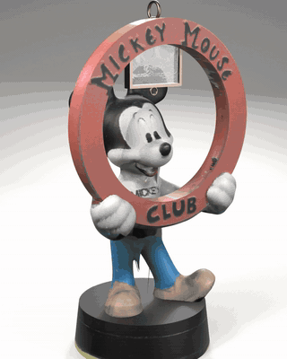
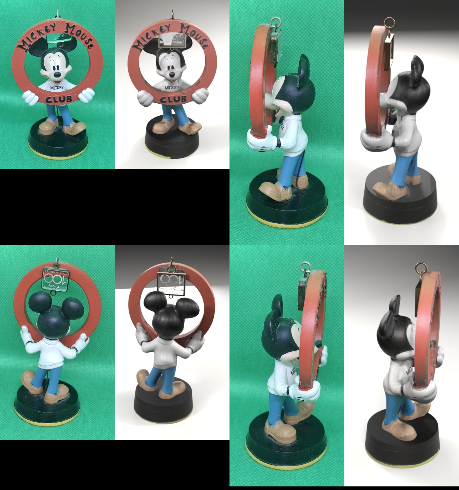
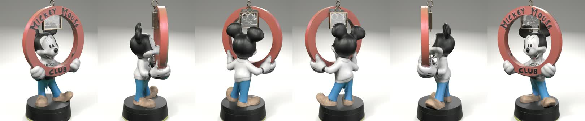
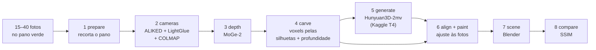
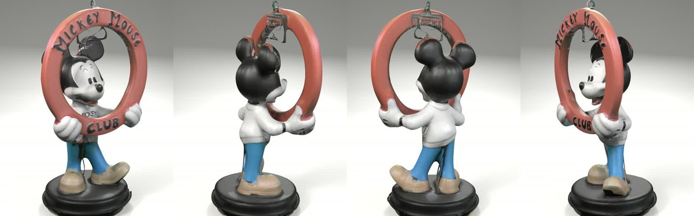
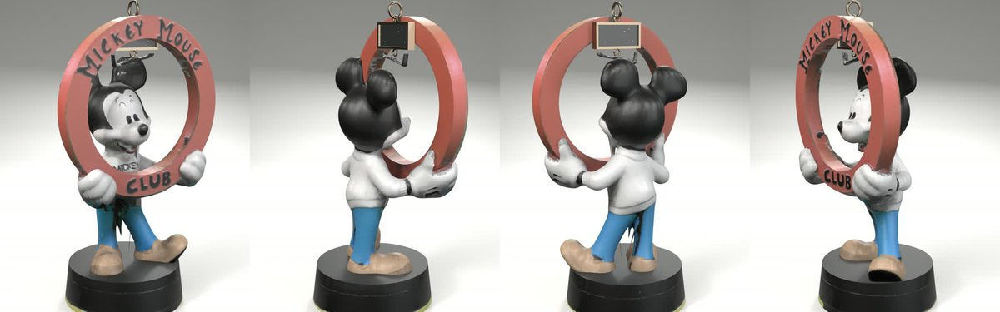
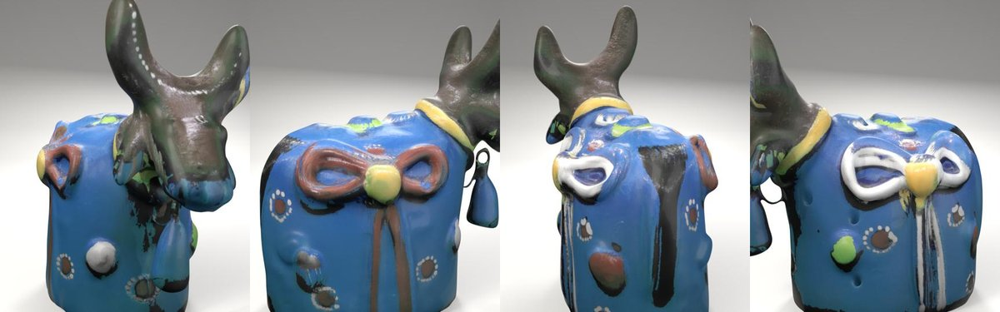

# twinlens: um celular, um pano verde e um modelo 3D pintado

🌐 [English](README.md) · **Português (Brasil)**

**Fotos de um objeto pequeno sobre um pano verde, transformadas por modelos de IA abertos num modelo 3D pintado e numa cena de estúdio no Blender.**

> Estudo pessoal de **Claudio Escudero** ([claudioescudero.com](https://claudioescudero.com) · [linkedin.com/in/claudioescudero](https://www.linkedin.com/in/claudioescudero/)). Não é um produto. O código está aberto para quem quiser ler, reproduzir os resultados e testar nos próprios objetos.

<p align="center">
  
</p>

**A pergunta:** 20 fotos de celular, um pano verde e modelos abertos conseguem gerar um modelo 3D pintado de um objeto pequeno, bom o bastante para um render de estúdio, num notebook e sem scanner?

**Resposta curta:** para forma e cor, sim. Numa estatueta com 20 fotos, todas as fotos foram posicionadas, a silhueta do modelo bate com as fotos com IoU 0,89, e os renders feitos pelas mesmas câmeras das fotos chegam a SSIM 0,67 no objeto. Letras pequenas, vidro e arame fino não saíram das fotos: precisaram de um perfil, um arquivo pequeno de regras só daquele objeto ([Perfis](#perfis-regras-para-um-objeto)). Um segundo objeto, rodado sem perfil, manteve a forma, mas ficou com manchas nas partes brilhantes ([O que deu errado](#o-que-deu-errado)).

## O resultado

Fotos (fundo verde) ao lado de renders do modelo pelas mesmas câmeras (fundo branco):



A cena de estúdio no Blender, de quatro ângulos:



A estatueta é do autor, fotografada numa mesa: 20 fotos com zoom digital de 1,75×, todas mais ou menos na mesma altura.

## Como funciona



| Passo | Código | O que faz |
|---|---|---|
| 1 | [`prepare.py`](twinlens/prepare.py) | Endireita as fotos (EXIF) e recorta o pano, medido na borda de cada foto. Um pixel é pano quando é quase tão verde quanto o pano ("excesso de verde" `G − max(R, B)`, pelo menos 40% do do pano) **e** tem o mesmo tom do pano (cromaticidade, dentro de 6 vezes a variação do próprio pano). Aí o `run` para para você conferir as máscaras. |
| 2 | [`cameras.py`](twinlens/cameras.py) | Descobre de onde cada foto foi tirada. Pontos ALIKED só no objeto, pares do LightGlue entre fotos vizinhas e o mapper do COLMAP. A distância focal vem do EXIF (equivalente 35 mm × zoom digital). |
| 3 | [`depth.py`](twinlens/depth.py) | Profundidade com MoGe-2 para cada foto, na CPU. |
| 4 | [`carve.py`](twinlens/carve.py) | Esculpe voxels pelas silhuetas e depois pela profundidade (um voxel que uma foto atravessou é ar). Só isso já dá um modelo pintado completo. Também descobre o "para cima": as fotos rodeiam o objeto, então o plano delas dá a vertical, e a mesa sai do pixel mais baixo da silhueta em cada foto. |
| 5 | [`generate.py`](twinlens/generate.py) | O Hunyuan3D-2mv transforma 4 fotos (frente, lados e costas; escolhidas pelo ângulo, sem fundo e sem reflexo verde) numa malha lisa e fechada. Roda numa T4 grátis do Kaggle: a ferramenta sobe um dataset privado, envia um kernel privado, espera e baixa uma malha por seed. |
| 6 | [`align.py`](twinlens/align.py), [`paint.py`](twinlens/paint.py) | Coloca cada malha gerada onde as fotos dizem: rotação, translação e escala por eixo que maximizam o IoU das silhuetas em todas as fotos. O relevo fino é suavizado, para que os detalhes pequenos venham da pintura das fotos e não de um relevo gerado um pouco fora do lugar. Todos os candidatos são pintados, e fica o melhor pelo IoU e pela concordância entre fotos. |
| 7 | [`scene.py`](twinlens/scene.py) | Cena de estúdio no Blender: fundo infinito, três luzes suaves, animação girando, imagens e vídeo. |
| 8 | [`compare.py`](twinlens/compare.py) | Renders pelas câmeras reais ao lado das fotos, com nota SSIM no objeto. |

**Pintura.** Cada vértice pega a cor da foto que mais concorda com as outras, entre as 5 que o veem mais de frente (visibilidade por z-buffer). Esse medoide ponderado deixa uma foto que caiu na peça errada perder na votação, e nenhuma cor é inventada por mistura. O reflexo verde é removido, nunca além do cinza. Pontos em que as fotos discordam pegam a cor dos vizinhos.

Tudo roda na CPU de um notebook, menos o passo 5, que roda na GPU do Kaggle e pode ser pulado (`--gpu none` fica com o modelo esculpido).

## Perfis: regras para um objeto

O núcleo não sabe nada sobre nenhum objeto em particular. Um perfil é um arquivo Python com ganchos opcionais:

```python
def refine_voxels(occ, ctx): ...      # passo 4: regras extras de escultura
def parts(mesh, ctx): ...             # passo 6: troca peças por formas exatas -> (mesh, {nome: peça}, estado)
def clean_colours(mesh, ctx): ...     # passo 6: regras de cor depois da pintura
```

`ctx` traz a configuração, as fotos com suas câmeras (`views`), o referencial em pé (`frame`) e o pedestal, se houver. Perfis podem marcar materiais no alfa do vértice: 160 = metal, 80 = vidro.

[`examples/mickey/profile.py`](examples/mickey/profile.py) é o perfil da estatueta que deu origem ao estudo. O aro, a plaquinha de vidro e o gancho de arame são desenhados como vetores, medidos no modelo, e o aro é ajustado às silhuetas das fotos (IoU 0,84 → 0,87). Isso deixou nítidas as letras do aro, o que pintar o aro gerado não conseguia. As regras de cor sabem que só a língua é vermelha e que sapatos e luvas têm cor chapada.

| Só o núcleo | Com o perfil |
|---|---|
|  |  |

## O que deu errado

| O que aconteceu | Evidência | O que mudou |
|---|---|---|
| O SIFT clássico não conseguiu posicionar as fotos | 8 de 20 fotos de plástico liso posicionadas | Pontos aprendidos no recorte do objeto (ALIKED + LightGlue): 20 de 20 |
| O celular grava a focal óptica mesmo com zoom digital | As fotos estavam em 1,75×, e a primeira solução de câmeras saiu errada | A focal é multiplicada pelo zoom lido do EXIF |
| Silhuetas não enxergam concavidades | Com todas as fotos na mesma altura, a escultura deixou "tendas" entre as partes, e as orelhas saíram quadradas | A profundidade ajuda; uma forma gerada e ajustada às fotos resolve |
| "Verde" não basta para achar o pano | Só o excesso de verde recortava tinta verde e as bordas de partes escuras e brilhantes que refletem o pano. Só o tom do pano recortava cavidades escuras iluminadas só pela luz verde | O pixel precisa passar nos dois testes, com o pano medido na borda de cada foto |
| Superfícies brilhantes refletem o pano | Plástico preto virou azul-petróleo e branco virou verde-menta. Tirar verde demais deixou brancos magenta, e medianas por canal inventaram azul | Nunca tirar o verde além do cinza; cores por medoide em vez de mediana |
| O relevo gerado fica um pouco fora do real | O sombreamento dele duplicava os olhos e as letras pintados | O relevo fino é suavizado antes da pintura |
| Letras pequenas, vidro e arame fino | A plaquinha e o gancho saíram embolados ([Só o núcleo](#perfis-regras-para-um-objeto)) | Desenhados como vetores pelo perfil |
| Blender | O AgX estourava cores claras para branco; faces coplanares brigavam (z-fighting); o Blender 5 tirou a saída FFmpeg | Transformação de vista Standard; o vídeo é montado a partir dos quadros com ffmpeg |
| Um segundo objeto sem perfil (um *bumba-meu-boi* de barro, 25 fotos) | A forma está certa, mas os chifres marrons brilhantes pegaram o verde do pano, e o corpo tem riscos pretos (abaixo) | Não resolvido. Um perfil poderia repintar, como o da estatueta faz |
| `compare.jpg` do segundo objeto | Os renders mostram o objeto minúsculo e longe, então ele ficou sem SSIM | Não resolvido |



## Reproduzir

**Requisitos:** Linux, Python 3.10–3.12, [uv](https://docs.astral.sh/uv/), [Blender](https://www.blender.org/) 4.2+ no `PATH` (testado com a 5.3), FFmpeg e, para o passo 5, uma conta grátis no [Kaggle](https://www.kaggle.com/) com o token da API em `~/.kaggle` (kaggle.com › Settings › API).

```bash
git clone https://github.com/escudero/twinlens && cd twinlens
uv venv --python 3.12 .venv && uv pip install --python .venv -e .

.venv/bin/twinlens run ~/fotos/meu-objeto --work work/meu-objeto
```

O `run` para uma vez depois do recorte do pano: confira `work/meu-objeto/out/masks_preview.jpg` (o contorno amarelo deve abraçar o objeto) e responda `y` para seguir. `--yes` pula a pergunta.

Os resultados ficam em `work/meu-objeto/out/`:

| Arquivo | O que é |
|---|---|
| `model.ply` | o modelo: cores por vértice vindas das fotos, Z para cima, apoiado em z = 0 |
| `model.blend` | cena de estúdio: fundo infinito, três luzes suaves, animação girando |
| `turntable.mp4`, `stills/` | vídeo girando de 8 s (1080 × 1350) e quatro ângulos |
| `compare.jpg` | suas fotos ao lado de renders pelas mesmas câmeras |
| `model_carved.ply` | o modelo feito só com as fotos (sem o passo na GPU) |
| `masks_preview.jpg`, `check_*.jpg` | o recorte do pano (partes cortadas escurecidas, avisos em vermelho) e o ajuste das silhuetas, para conferir |

Cada passo salva seus resultados na pasta de trabalho, e o `run` pula os passos prontos, então ele retoma depois de uma interrupção. Os passos também rodam um a um: `twinlens carve FOTOS --work PASTA`.

Opções: `--gpu none` (só as fotos, sem Kaggle), `--seeds 1,2,3,4` (candidatos gerados), `--pedestal` (o objeto fica numa base redonda, que é redesenhada exata), `--height-cm 12` (escala real), `--profile arquivo.py` (regras do objeto), `--no-video`, `--yes`.

As fotos da estatueta não estão no repositório. Com fotos suas dela, o perfil roda com `--pedestal --profile examples/mickey/profile.py`.

### Como tirar as fotos

- **Pano:** um pano verde embaixo e atrás do objeto, ocupando a foto até as bordas, porque é na borda de cada foto que a cor do pano é medida. Detalhes verdes no objeto não atrapalham, desde que não tenham o mesmo tom do pano. Luz suave e uniforme.
- **Fotos:** de 15 a 40, dando a volta inteira mais ou menos na mesma altura, um pouco acima do objeto (10–20°). Mantenha 10–20° entre as fotos, para que fotos vizinhas se sobreponham.
- **Enquadramento:** o objeto inteiro em todas as fotos. Trave foco e exposição se o celular permitir e **desligue o zoom digital**. O zoom é lido do EXIF e corrigido, mas custa resolução.
- **Superfícies de cima:** uma segunda volta de fotos de uns 35° acima ajuda nelas e nos vãos entre as partes.

## Estrutura do repositório

```
twinlens/           o pipeline, um módulo por passo (python -m twinlens)
  kaggle_kernel.py  o script que roda o Hunyuan3D-2mv no Kaggle
  geometry.py       projeção, rasterização e IoU de silhueta usados pelos passos
examples/mickey/    o perfil da estatueta
docs/media/         as imagens deste README
work/               fotos e tudo o que o pipeline gera, ignorado pelo git
```

## Limitações

- **A forma gerada é um palpite.** Ela é condicionada a 4 fotos, não medida. Rosto e detalhes esculpidos podem diferir do objeto real; o `compare.jpg` mostra quanto.
- **Letras pequenas saem borradas.** Arames finos e partes transparentes (vidro) precisam de perfil.
- **Fotos:** supõe fotos tiradas em volta do objeto, numa altura parecida, com a primeira foto sendo a frente.
- **Dois objetos.** Os limiares foram ajustados na estatueta; o segundo objeto é o único teste sem perfil.
- **Kaggle** tem fila e limite de GPU grátis; sem ele, o resultado é o modelo esculpido.

## Créditos e licenças

- **Código:** © 2026 Claudio Escudero, [MIT](LICENSE).
- **Fotos e imagens** em `docs/media/`: do autor. A estatueta é um produto Disney (Mickey Mouse é marca da Disney); este estudo não tem ligação nem aval da Disney.
- [Hunyuan3D-2mv](https://github.com/Tencent-Hunyuan/Hunyuan3D-2) (Tencent), Tencent Hunyuan Community License, que tem limites de território. Ele é baixado e roda na sua própria conta do Kaggle, não vem junto aqui.
- [MoGe-2](https://github.com/microsoft/MoGe) (Microsoft), pesos `Ruicheng/moge-2-vitl-normal`.
- [ALIKED e LightGlue](https://github.com/cvg/LightGlue) (cvg, ETH Zurich), [COLMAP](https://colmap.github.io/) / pycolmap.
- [Blender](https://www.blender.org/), trimesh, scikit-image, SciPy, OpenCV, FFmpeg e o Kaggle pela GPU grátis.

O código e os pesos dos modelos são baixados dos autores, não redistribuídos aqui. Confira a licença dos pesos no card de cada modelo antes de reutilizar.
